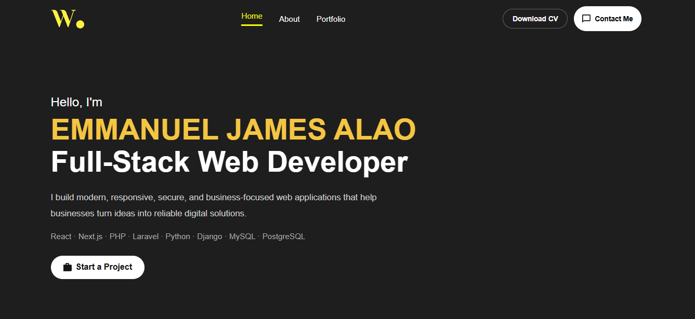
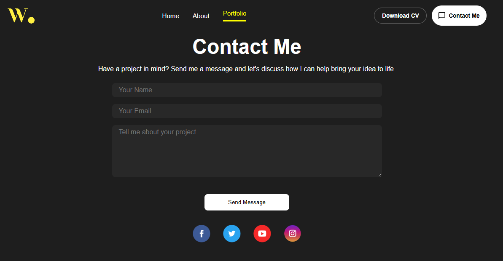
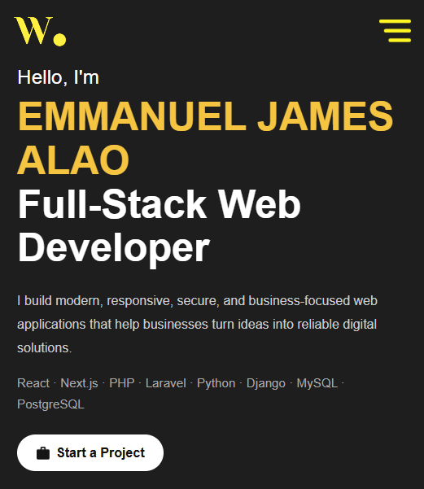

# Emmanuel Alao — Developer Portfolio

Welcome to my developer portfolio! I am a **Full-Stack Web Developer** focused on building responsive websites, web applications, administrative dashboards, and database-driven systems.

This repository contains the source code for my personal portfolio, showcasing my development skills, projects, and professional background.

🌐 **Live Portfolio:** [emmanuel-alao-portfolio.vercel.app](https://emmanuel-alao-portfolio.vercel.app/)

## Screenshots

The following screenshots showcase the portfolio interface and its responsive design.

### 1. Portfolio Homepage



### 2. Projects Section


### 3. Contact Section



### 4. Mobile View



> **Note:** Replace these image references with screenshots captured from your actual website. GitHub will display the images after you upload the corresponding files to the `screenshots` folder.

## About Me

I build practical web solutions with an emphasis on responsive design, maintainable code, and user-friendly interfaces. My work spans frontend development, backend integration, API development, database management, and deployment.

I am interested in opportunities to collaborate with businesses and development teams on useful, reliable web applications.

## Tech Stack

The technologies I work with include:

- **Frontend:** React, Next.js, TypeScript, JavaScript, HTML5, CSS3, Tailwind CSS
- **Backend:** Node.js, REST APIs
- **Databases:** MySQL, PostgreSQL
- **Tools & Deployment:** Git, GitHub, Vercel

*Technology lists may include tools used across my projects, not necessarily every technology used in this portfolio repository.*

## Featured Projects

Explore my GitHub repositories for examples of my development work.

### 1. Cooperative Loan Management System

A cooperative management application focused on supporting member accounts, loan workflows, and administrative operations.

**Technologies:** Next.js, TypeScript, MySQL, Prisma

[View Repository](https://github.com/emmy-tech247/Loan-management-system-using-Next.js)

### 2. Real Estate Website

A real estate web project built with modern frontend technologies, designed to present property information through a responsive user interface.

**Technologies:** Next.js, TypeScript, Tailwind CSS

[View Repository](https://github.com/emmy-tech247/real-estate-using-next.js)

## Portfolio Features

- Personal and professional introduction
- Project showcase
- Responsive website layout
- Portfolio presentation of development skills
- Links to relevant projects and professional work

## Getting Started

To run this project locally, ensure you have Node.js and npm installed.

### 1. Clone the repository

```bash
git clone https://github.com/emmy-tech247/emmanuel-alao-portfolio.git
```

### 2. Navigate into the project directory

```bash
cd emmanuel-alao-portfolio
```

### 3. Install dependencies

```bash
npm install
```

### 4. Start the development server

```bash
npm run dev
```

Open the local URL displayed in your terminal to view the application.

### 5. Build for production

```bash
npm run build
```

## Deployment

The portfolio is deployed on Vercel:

[Visit My Portfolio](https://emmanuel-alao-portfolio.vercel.app/)

## Connect With Me

- **GitHub:** [@emmy-tech247](https://github.com/emmy-tech247)
- **Portfolio:** [emmanuel-alao-portfolio.vercel.app](https://emmanuel-alao-portfolio.vercel.app/)

For professional collaborations, freelance projects, or software development opportunities, please reach out through the contact options available on my portfolio.

---

*Designed and developed by Emmanuel Alao.*
